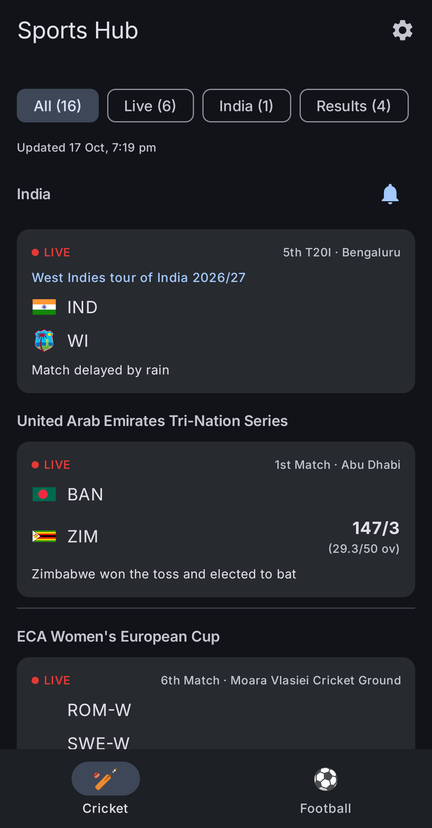
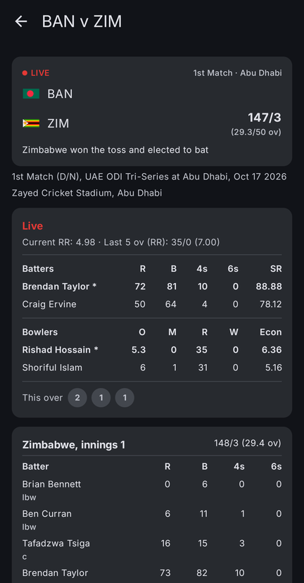
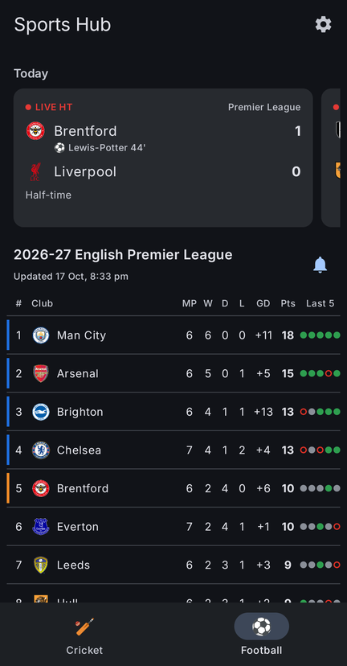
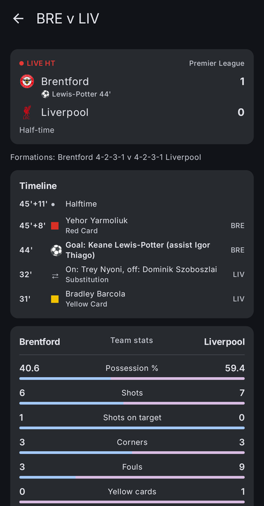

# Sports Hub (Android)

[](https://developer.android.com/)
[](https://developer.android.com/about/versions/oreo)
[](https://developer.android.com/about/versions/15)
[](https://kotlinlang.org/)
[](https://developer.android.com/jetpack/compose)
[](https://www.espncricinfo.com/)
[](LICENSE)

> **Disclaimer.** Provided **AS IS**, with no warranty, express or implied. **Use it entirely at your own risk.**
> The author is not liable for any loss or damage arising from its use, including from wrong or late scores.
> Do not rely on it for betting or any decision with consequences. It is not certified for regulated,
> safety-critical or high-assurance use. [LICENSE](LICENSE) is the governing text and prevails where this
> summary differs. This is not legal advice; see a lawyer for anything high-stakes.

Multi-sport scores for Android, one tab per sport.

<p>
  
  
  
  
</p>

## Features

### Cricket (home tab)

- Match cards in the ESPNcricinfo style: status, match and city ("5th T20I · Bengaluru"), team flags and
  scores exactly as the feed gives them ("166/4 (35.5/50 ov, target 257)").
- **India first**: India's matches sit in a full-width strip at the top (a setting turns this off).
- **Filter chips** with counts: All, Live, India, Results.
- **Upcoming matches** show the start day and time in your own time zone and a live countdown
  ("Starts in 31 min").
- **Finished matches** dim the losing side.
- **Scorecard** on tap: batting (R, B, 4s, 6s, dismissal) and bowling (O, M, R, W) for every innings,
  refreshed every 30 s while the match is live.
- **Live panel** above the scorecard while a match is on, as on Cricinfo: current and required run rate,
  the last 5 overs, the two batters (striker starred, R B 4s 6s SR), the two bowlers (O M R W Econ) and
  this over's balls.
- **Rain delays and other stops** ("Match delayed by rain", stumps, innings breaks) show on the card.
- Auto refresh: every 30 s while a match is live (15, 30 or 60 s in Settings), every 5 min otherwise, and
  pull to refresh at any time.

### Football

- **Live match cards**: today's matches in a strip at the top, with LIVE and the minute, half-time,
  full-time or the kick-off time, the score and the scorers under each side; the next matchday when
  there is no match today. Refreshed at the live rate while a match is on.
- **Match screen** on tap: formations, a timeline of goals (with the assist), cards and substitutions,
  and head-to-head team stats (possession, shots, on target, corners, fouls, cards, offsides, saves,
  passes).
- **English Premier League table**: MP, W, D, L, GD, Pts and **Last 5** form, with rank colours for the top
  four, fifth place and the bottom three. Short club names so the table fits a phone.
- **Stat leaders**: goals and assists, top five.
- **Club screen**: record, upcoming fixtures in local time, and results.
- A highlighted favourite club (Settings).

### Live alerts (off until you turn them on)

- **India cricket**: an update at the end of every over (optional), and alerts for every wicket, a new
  innings, a rain delay or other stop and the restart, and the result. "WICKET! IND 45/3 (6.2 ov)", "End of over 6: IND 49/1 (6 ov) · 9 runs".
- **Premier League**: goals with the scorer and minute ("GOAL! ARS 0-1 CHE · Cole Palmer (pen) 23'"),
  kick-off, half-time, full-time, and disallowed goals. All matches, or only your highlighted club.
- One notification per match, replaced as the match goes on. Tap it to open the match.
- Turn them on with the bell beside the India or Premier League heading, or in Settings.
- **How it works**: an exact alarm at the next start time wakes a foreground service, which polls a small
  scoreboard once a minute while a followed match is live and stops itself when nothing is. A check every
  30 minutes catches anything the alarm missed. A lost connection does not stop it, and if Android
  kills it anyway a watchdog alarm restarts it within five minutes. "Stop until next match" on the
  notification mutes the current match only.
- **Cost**: about 1 MB an hour per followed match while it is live; nothing between matches beyond the
  30-minute check. If the phone sits idle for a long time, Android may hold updates back; Settings offers
  the battery exemption that prevents this.

### Always something on screen

- Every successful response is saved on the phone, so the app opens on the last scores it showed, before
  the network answers.
- A failed refresh keeps the scores on screen and says so: "Offline. Showing scores from 17 Oct, 6:25 pm".
- Every screen shows when its data was last updated.

### Adding a sport

One `SportTab` entry, one repository and one screen. The navigation bar is built from the registry.

## Data

Scores and tables come from ESPN's public JSON service, which carries the ESPNcricinfo cricket data. The
Cricinfo website and its own API sit behind Akamai and answer 403, so the app does not use them. No API key.
Requests are paced and retried with backoff, and automatic refreshes are skipped while the data is still
fresh. Not affiliated with or endorsed by ESPN, ESPNcricinfo or the Premier League.

## Permissions

| Permission | Why |
|---|---|
| `INTERNET` | Scores and tables. |
| `POST_NOTIFICATIONS` | Live alerts. Asked for only when you turn an alert on. |
| `FOREGROUND_SERVICE`, `FOREGROUND_SERVICE_SPECIAL_USE` | Following a live match, with a visible notification, only while one is in play. |
| `WAKE_LOCK` | Keeps the one-minute poll on time with the screen off, only while a match is followed. |
| `USE_EXACT_ALARM` (`SCHEDULE_EXACT_ALARM` on Android 12) | Waking up at a match's start time. |
| `REQUEST_IGNORE_BATTERY_OPTIMIZATIONS` | Lets Settings offer the battery exemption; nothing changes unless you allow it. |

## Install

Build it (below) and install the APK with `adb install -r`, or copy it to the phone and open it.
Android 8.0 (API 26) or later. The release APK is named after the app id, `com.pandiyarajk.sportshub.apk`.

## Building

Needs JDK 17 and the Android SDK (compileSdk 35).

```bash
./gradlew :app:assembleDebug :app:testDebugUnitTest   # build and run the unit tests
./gradlew :app:installDebug                           # install on a connected phone
./gradlew :app:assembleRelease                        # signed when keystore.properties exists
```

On Windows use `gradlew.bat`. Release signing reads a gitignored `keystore.properties` in the project
root with `storeFile`, `storePassword`, `keyAlias` and `keyPassword`. Without it the release build is
unsigned; use your own key, never commit one.

Unit tests run against real captured ESPN responses in `app/src/test/resources/`, with ESPN's written
commentary text removed.

## Built with

Kotlin, Jetpack Compose and Material 3 (dynamic colour, light and dark), OkHttp, kotlinx.serialization,
DataStore and Coil. No Hilt, Room or navigation library.

## License

MIT. See [LICENSE](LICENSE).
